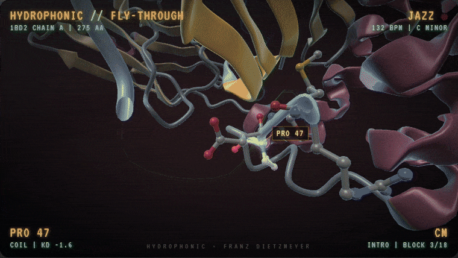
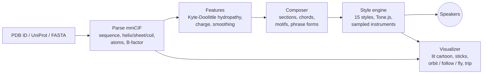
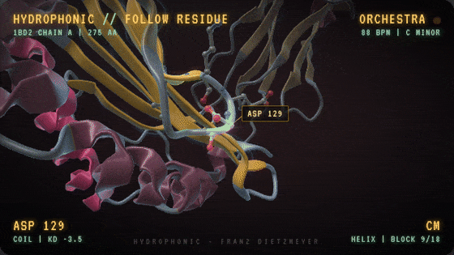
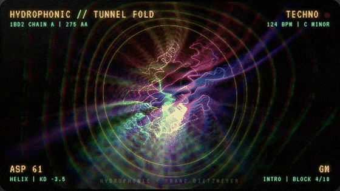
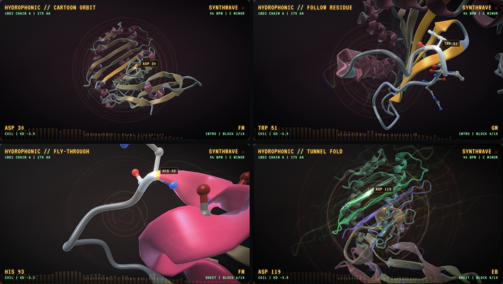
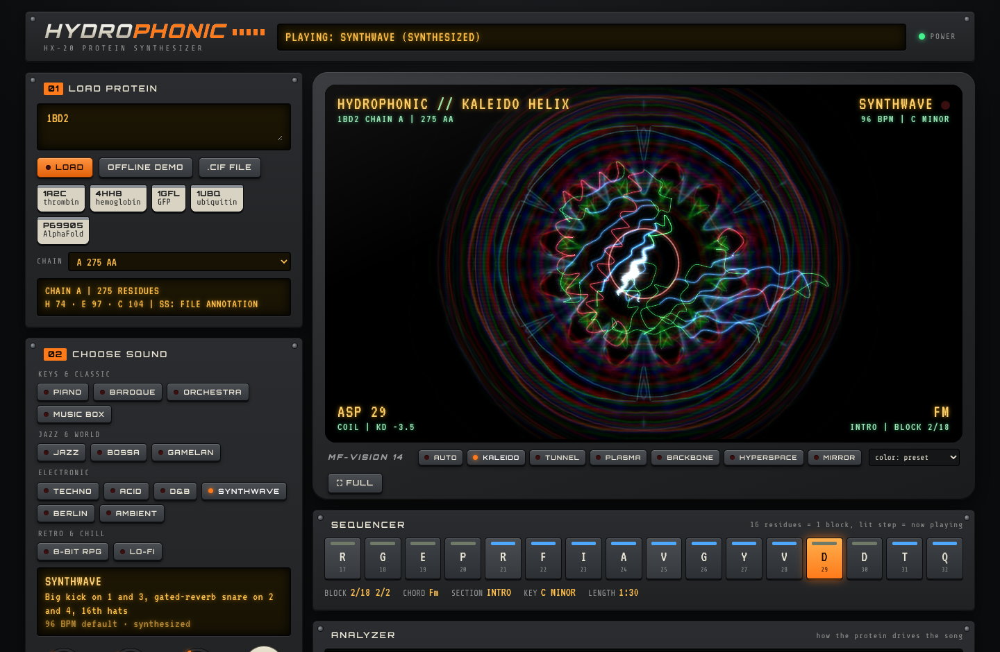

<div align="center">

```
    __  ____  ______  ____  ____  ____  __  ______  _   ____________
   / / / /\ \/ / __ \/ __ \/ __ \/ __ \/ / / / __ \/ | / /  _/ ____/
  / /_/ /  \  / / / / /_/ / / / / /_/ / /_/ / / / /  |/ // // /
 / __  /   / / /_/ / _, _/ /_/ / ____/ __  / /_/ / /|  // // /___
/_/ /_/   /_/_____/_/ |_|\____/_/   /_/ /_/\____/_/ |_/___/\____/

                    HX-20  PROTEIN  SYNTHESIZER
```

**Protein in. Music out.**

Type a PDB ID, a UniProt accession or a raw sequence.
Hydrophonic reads the fold, composes a song in one of 15 styles
and flies you through the structure while it plays, always looking at the amino acid you hear.




<sub>FLY mode: PDB 1BD2, chain A, played as a jazz trio. The residue you hear is drawn as sticks.</sub>

</div>

---

## Why

A protein is a sequence of 20 letters folded into helices, sheets and loops.
Turning that 1:1 into notes sounds like a cat on a keyboard: neighbouring residues barely correlate.

Hydrophonic does what a musician would do. It listens to the protein on several time scales,
lets slow properties shape the song and lets single residues add detail.
The result is music you would actually leave on, and every song is still a fingerprint of its protein.

## How a fold becomes a song



| Level | Changes every | Read from the protein | Becomes |
|---|---|---|---|
| Song | once | net charge, mean hydropathy, sequence hash | major or minor, key, random seed |
| Section | 64 residues | majority secondary structure, with hysteresis | arrangement, chord pool, instruments, visual preset |
| Block | 16 residues | smoothed hydropathy, charge density | chord, melody contour, filters, rhythm density, color |
| Step | 1 residue | residue identity, with probability = **BIO** knob | melodic interval, accents, ghost notes, sticks and camera target |

Two knobs make the trade-off explicit:

- **BIO** at 0% lets the composer write freely, steered only by the slow features. At 100% each residue picks the next melodic step.
- **RAW 1:1** switches to the naive mapping, so you can hear why the composer exists.

## Styles

| Group | Style | What the protein does |
|---|---|---|
| Keys & classic | **Piano** | Left-hand pattern changes with helix, sheet and coil; right hand sings the hydropathy contour |
| | **Baroque** | Helix and coil: a canon one beat later. Sheet: the second voice is the mirror image of the first |
| | **Orchestra** | The melody instrument follows the fold: helix horn, sheet trumpet, coil flute. Aromatics ring the glockenspiel |
| | **Music box** | A slow lullaby over the contour, for kids and outreach |
| Jazz & world | **Jazz trio** | Walking bass; the charge of a residue decides whether the approach note comes from above or below |
| | **Bossa nova** | Nylon guitar, clave and flute over jazz progressions |
| | **Gamelan** | Slendro tuning for basic proteins, pelog-like for acidic ones. Even and odd residues interlock as polos and sangsih |
| Electronic | **Deep Techno** | Sidechain pump, dub chords, a riser before every section that brings more energy |
| | **Acid** | One residue per 16th of a 303 line: charged = accent, glycine = ghost, proline = slide |
| | **Drum & Bass** | Reese bass, two-step breaks, ghost snares where charged residues sit |
| | **Synthwave** | Gated snare, Juno pads, a gliding saw lead in helix and sheet sections |
| | **Berlin School** | An 8-step sequencer motif built from the residues, mutated by charge |
| | **Ambient** | Crossfading pads; flexible regions (high B-factor) smear into the echo |
| Retro & chill | **8-bit RPG** | Four handheld channels, bouncy melody, harmony a third below on the repeat |
| | **Lo-fi** | Swing, rootless 7th/9th voicings, vinyl crackle |

## The visualizer

Two families of views share one WebGL2 renderer.

**Structure views** show the real fold, like a molecular viewer that listens:

- A lit **cartoon**: helices as ribbons, strands as arrows, loops as tubes, with multisampled anti-aliasing, rim light and depth fog.
- The residue being played appears as **sticks** (all heavy atoms, CPK colors), with the previous three fading out, plus a floating label.
- Already played parts keep their color, the rest of the chain waits desaturated.
- **Orbit** circles the whole protein, **Follow** keeps the played residue in frame, **Fly** travels along the backbone and always looks at the residue that is sounding.
- **AUTO** switches between them with the song sections. Audio drives the rim light, a soft aura, the glow on the current residue and thin spectrum bars.

**Trip views** are an original engine built on the classic MilkDrop recipe: warp the last frame, let it decay, draw new shapes into it.
The main shape is the glowing backbone. Six presets: Kaleido Helix, Tunnel Fold, Plasma Drift, Backbone Scope (the backbone becomes the oscilloscope), Hyperspace, Mirror Crystal.

Color the protein by secondary structure, by position along the chain (N to C) or by hydropathy.
Kicks and snares come straight from the score, so pulses hit exactly on the beat.

<table>
<tr>
<td align="center"><br><sub><b>FOLLOW</b>, orchestra</sub></td>
<td align="center"><br><sub><b>TRIP</b> / Tunnel Fold, deep techno</sub></td>
</tr>
</table>



## The HX-20

Everything sits on one 90s-style rack unit: load a protein (01), choose a sound (02), play (03).
The 16-step LED sequencer shows the residues of the current block, the analyzer shows how hydropathy, flexibility and structure drive the song.



## Quick start

```bash
git clone https://github.com/franzdietzmeyer/hydrophonic.git
cd hydrophonic/web
python3 -m http.server 8000
```

Open <http://localhost:8000>, then:

1. **Load**: type `1A2C` (or a UniProt ID like `P69905`, or paste a FASTA) and press LOAD.
2. **Sound**: pick a style, turn the knobs.
3. **Play**: press PLAY, then `F` for fullscreen.

No internet? Press **OFFLINE DEMO**: instruments fall back to synthesizers, but Tone.js still needs to have loaded once.

| Key | Action |
|---|---|
| `Space` | play / stop |
| `F` or double-click the screen | fullscreen |
| `N` | next visual preset (structure and trip) |
| double-click a knob | reset it |
| `Shift` + drag a knob | fine adjustment |

## Inputs

| Input | Source | Structure |
|---|---|---|
| PDB ID, e.g. `4HHB` | RCSB PDB | from the file; longest chain selected, all chains switchable |
| UniProt accession, e.g. `P69905` | AlphaFold DB | predicted model; pLDDT is used as flexibility |
| FASTA or plain sequence | pasted | none: a generated path is shown and clearly labeled |
| `.cif` file | your disk | from the file; secondary structure estimated from CA geometry if the file has none |

## Project structure

```
web/
  index.html          the built, self-contained app (this is what gets deployed)
  src/
    ui.html           layout and styles of the HX-20
    bio.js            mmCIF and FASTA parsing, secondary structure, features
    engine.js         song structure, composer, sample loading, scheduling
    styles_*.js       the 15 music styles
    viz.js            WebGL2 visualizer
    app.js            controls, knobs, sequencer strip, analyzer
    demo.js           offline demo (PDB 1BD2, chain A)
    build.py          inlines everything into web/index.html
legacy/streamlit/     the first Python prototype
docs/                 README media
```

After changing anything in `web/src`:

```bash
python3 web/src/build.py
```

## Roadmap

- [ ] Disulfide bonds as call and response, binding sites as special events
- [ ] MIDI export
- [ ] Sampled drum kits
- [ ] Shareable links (protein + style + variation in the URL)

## Credits

Structures from [RCSB PDB](https://www.rcsb.org/) (CC0) and [AlphaFold DB](https://alphafold.ebi.ac.uk/) (CC BY 4.0, Jumper et al., *Nature* 2021).
Audio by [Tone.js](https://tonejs.github.io/). Samples: Salamander Grand Piano by Alexander Holm (CC BY 3.0) and FluidR3 GM by Frank Wen (MIT).
Visualizer inspired by MilkDrop (Ryan Geiss); no MilkDrop code is used.
Full list in [CREDITS.md](CREDITS.md).

## Citing

If you use Hydrophonic in a talk, a course, an exhibition, a publication or a derived work, please cite it.
GitHub shows a **"Cite this repository"** button (from [CITATION.cff](CITATION.cff)), or use:

> Dietzmeyer, F. (2026). *Hydrophonic: protein-to-music synthesizer with an audio-reactive structure visualizer* (Version 0.5.0) [Computer software]. https://github.com/franzdietzmeyer/hydrophonic

## License

Copyright (C) 2026 Franz Dietzmeyer. Licensed under the **[PolyForm Noncommercial License 1.0.0](LICENSE)**.

- **Free for non-commercial use:** personal projects, study, research, teaching, schools, universities, public research organizations and charities.
  You may use, modify and share it for these purposes.
- **Keep the notices:** anyone who passes on a copy, modified or not, must include the license and the `Required Notice` lines naming the author.
- **Commercial use needs a separate license.** Get in touch via GitHub.

Versions published before October 23, 2026 were released under MIT (first commit) and AGPL-3.0; those copies keep the license they were published with.
Third-party samples and data keep their own licenses (see [CREDITS.md](CREDITS.md)).

<div align="center"><sub>Made by Franz Dietzmeyer. Every protein has a song; most of them just never got the chance.</sub></div>
